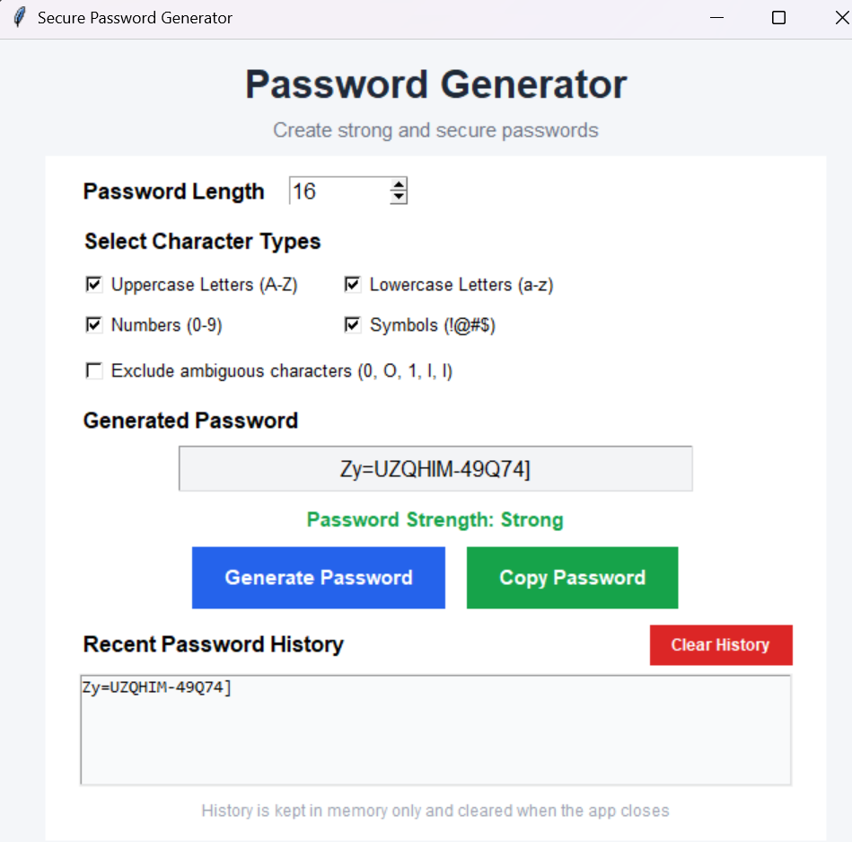
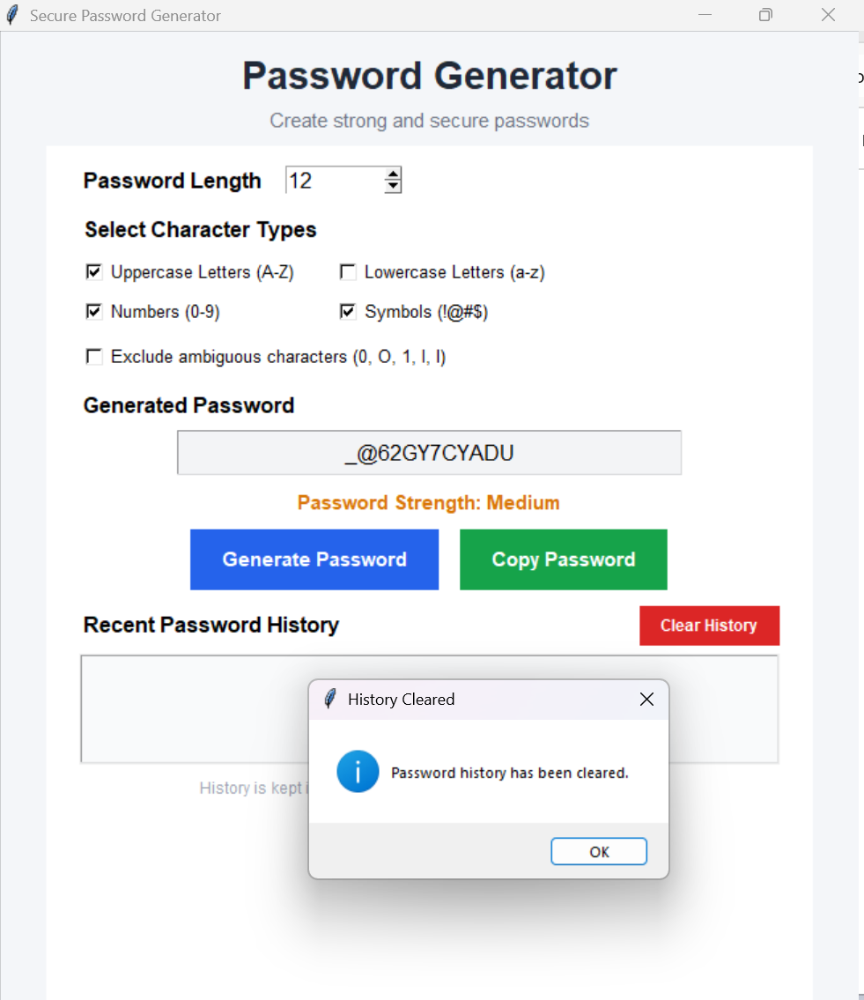

# Random Password Generator

## About the Project

I developed this Random Password Generator using Python as part of my Oasis Infobyte Python Programming Internship.

The main purpose of this project is to help users create random passwords by selecting their preferred password length and character types.

I created a graphical interface using Tkinter so that users can generate and copy passwords without using the terminal.

## Features

The application includes the following features:

- Select password length between 8 and 64 characters.
- Choose uppercase and lowercase letters.
- Include numbers and special symbols.
- Option to exclude ambiguous characters.
- Generate random passwords using Python's `secrets` module.
- Display a basic password strength indicator.
- Copy the generated password using the Copy button.
- View the last five generated passwords.
- Clear password history whenever required.
- Password history is kept in memory and is not permanently saved.

## Technologies Used

- Python 3.12
- Tkinter
- Secrets
- String
- Pyperclip

## Project Structure

```text
Python-Task3-RandomPasswordGenerator/
│
├── main.py
├── requirements.txt
├── README.md
└── screenshots/
```

## How to Run the Project

**Step 1: Clone the repository**

```bash
git clone https://github.com/sujit-prajapati/OIBSIP.git
```

**Step 2: Open the project directory**

```bash
cd OIBSIP/Python-Task3-RandomPasswordGenerator
```

**Step 3: Create a virtual environment**

```bash
python -m venv .venv
```

**Step 4: Activate the environment (Windows)**

```powershell
.\.venv\Scripts\Activate.ps1
```

**Step 5: Install the required packages**

```bash
python -m pip install -r requirements.txt
```

**Step 6: Run the application**

```bash
python main.py
```

## How to Use

1. Open the application.
2. Enter the required password length.
3. Select the character types you want.
4. Choose whether to exclude ambiguous characters.
5. Click Generate Password.
6. Check the generated password and its strength.
7. Click Copy Password if you want to copy it.
8. Use Clear History to remove recent password entries.

## Password Strength

The application displays three strength levels: Weak, Medium and Strong.

The strength indicator uses password length and character diversity to provide a basic estimate. It is not a formal security assessment.

## Security

The application uses Python's `secrets` module to generate random passwords.

Generated passwords are not permanently stored by the application. Recent password history is maintained only while the application is running and is cleared when the application closes.

## Developer

**Sujit Prajapati**

GitHub: https://github.com/sujit-prajapati

## Internship Details

Oasis Infobyte Python Programming Internship

Task 3 – Random Password Generator

## Application Screenshots

### Main Window


### Generated Password


### Copy Confirmation


### Cleared Password History
