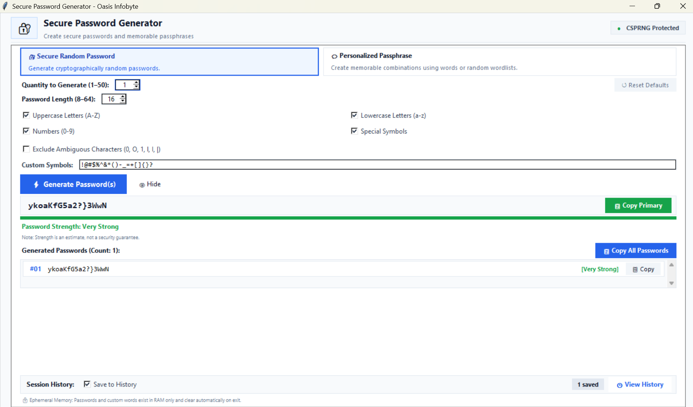
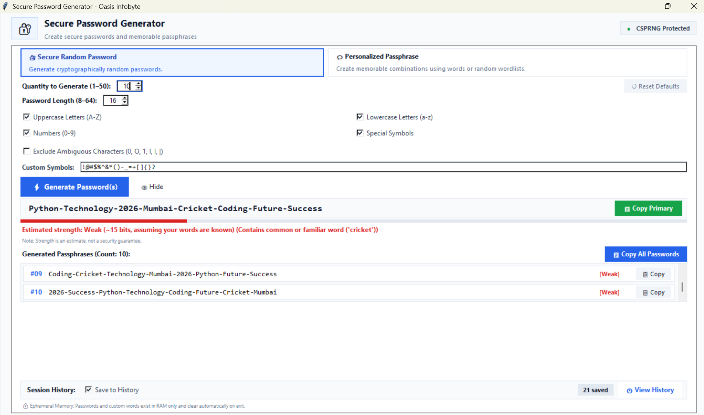
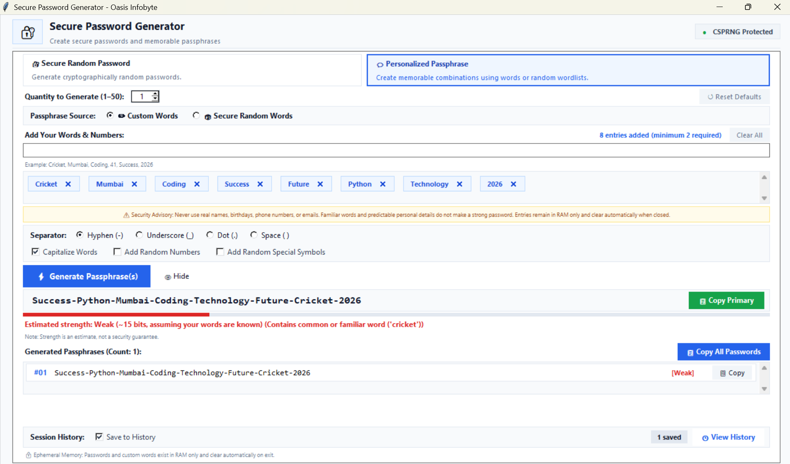
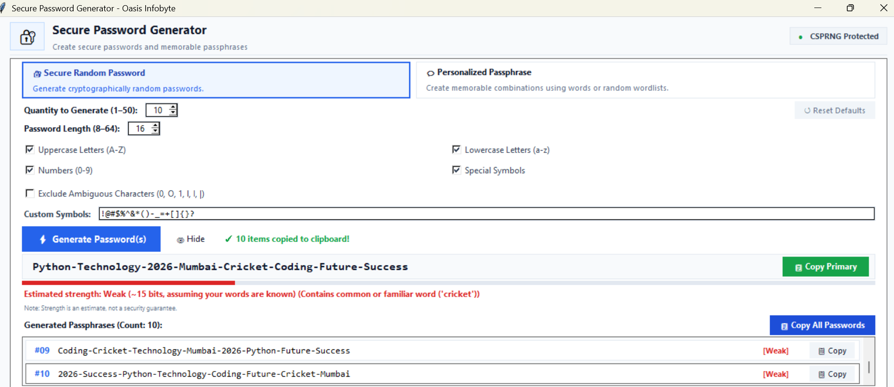
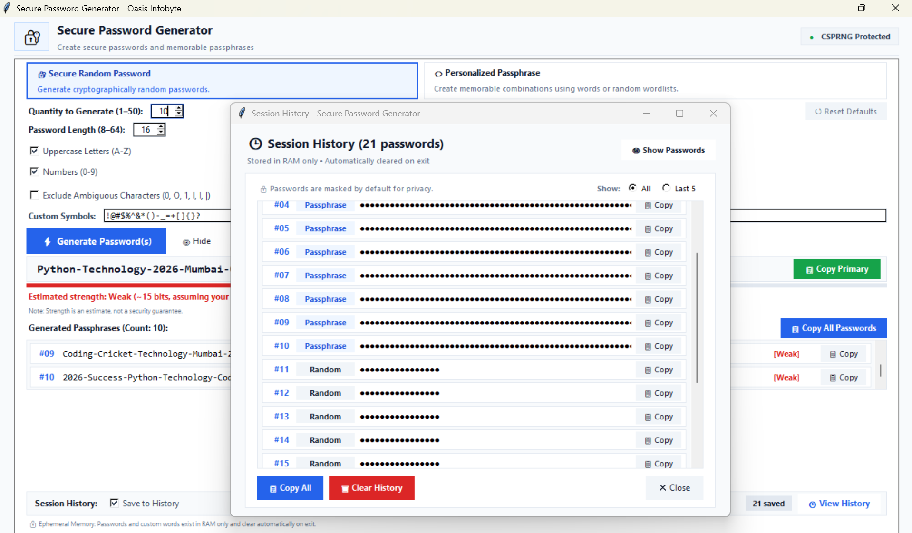

# Secure Password & Passphrase Generator

A modern desktop password generator built with Python and Tkinter as part of the **Oasis Infobyte Python Programming Internship – Task 3**.

## Introduction & Objectives

This application generates cryptographically strong passwords and customizable passphrases using Python's standard `secrets` module. All generated passwords, custom words, and session history remain in temporary memory (RAM only).

Key objectives:

- Provide a clean, responsive blue-and-white Tkinter interface.
- Separate password generation and validation logic from GUI code using `generator_core.py`.
- Support Secure Random Password and Personalized Passphrase modes.
- Provide transparent strength estimates without making misleading security claims.
- Keep sensitive data temporary and avoid persistent password storage.

## Features

### 1. Cryptographic Randomness & Privacy

- **CSPRNG Generation:** Uses Python's `secrets` module for secure random generation.
- **Show/Hide:** Toggle password visibility on the main interface.
- **RAM-Only Storage:** Passwords, passphrases, custom entries, and session history remain in memory and are cleared when the application closes.
- **Clipboard Integration:** Copy generated passwords and passphrases using Pyperclip with Tkinter fallback.

### 2. Mode 1 – Secure Random Password

- **Password Length:** Generate passwords from 8 to 64 characters.
- **Batch Generation:** Generate between 1 and 50 passwords in one operation.
- **Character Categories:** Choose uppercase letters, lowercase letters, numbers, and special symbols.
- **Category Validation:** Ensures at least two character categories are selected.
- **Ambiguous Character Filter:** Optionally excludes visually confusing characters such as `0`, `O`, `1`, `l`, `I`, and `|`.
- **Custom Symbols:** Supports validated printable ASCII special characters.

### 3. Mode 2 – Personalized Passphrase Builder

- **Smart Tag Input:** Enter multiple words or numbers separated by commas.
- **Automatic Cleaning:** Trims whitespace, removes empty entries, and prevents case-insensitive duplicates.
- **Removable Tags:** Add, remove, and clear custom entries.
- **Custom Words Source:** Generate combinations using user-provided entries.
- **Secure Random Words:** Generate memorable passphrases using a curated dictionary of 1,656 distinct English words.
- **Formatting Options:**
  - Hyphen (`-`)
  - Underscore (`_`)
  - Dot (`.`)
  - Space
  - Capitalize Words
  - Add Random Numbers
  - Add Random Special Symbols
- **Duplicate Prevention:** Avoids repeating generated combinations when possible.

### 4. Session History & Batch Controls

- **Batch Generation:** Generate 1–50 passwords or passphrases.
- **Scrollable Results:** View generated items in a scrollable results area.
- **Individual Copy:** Copy a selected generated item.
- **Copy All:** Copy all generated items from the current mode.
- **Session History:** View saved passwords and passphrases in a separate window.
- **Privacy Protection:** History entries are masked by default.
- **History Filters:** View all entries or the last five entries.
- **Clear History:** Clear saved entries with confirmation.
- **Save to History ON/OFF:** Control whether newly generated items are saved.
- **History Limit:** Stores up to 500 recent entries in memory.

### 5. Password & Passphrase Strength Estimation

The strength indicator provides a basic educational estimate based on password length, character diversity, and predictable patterns.

- **Random Password Model:** Evaluates character pool and length, with reductions for predictable patterns.
- **Custom Words Model:** Considers the number of unique entries and their ordering, while accounting for the risk of familiar words.
- **Secure Random Words Model:** Estimates entropy using the selected word count and dictionary size.

Strength ratings are estimates only and are not a formal security or entropy guarantee.

## Technologies Used

- **Python 3.12+**
- **Tkinter** – Standard Python GUI toolkit
- **Pyperclip** – Clipboard integration (`>=1.8.2`)
- **Python Standard Libraries:** `secrets`, `math`, `re`, `string`, `dataclasses`, and `itertools`

## Project Structure

```text
Python-Task3-RandomPasswordGenerator/
│
├── main.py
├── generator_core.py
├── wordlist.py
├── tag_input.py
├── test_generator_core.py
├── test_password_generator.py
├── requirements.txt
├── .gitignore
├── README.md
│
└── screenshots/
    ├── main-window.png
    ├── batch-generation.png
    ├── personalized-passphrase.png
    ├── copy-confirmation.png
    └── session-history.png
```

## Installation & Run Commands

### 1. Clone the Repository

```bash
git clone https://github.com/sujit-prajapati/OIBSIP.git
```

### 2. Open the Task 3 Folder

```bash
cd OIBSIP/Python-Task3-RandomPasswordGenerator
```

### 3. Create a Virtual Environment

```bash
python -m venv .venv
```

### 4. Activate the Virtual Environment

**Windows PowerShell:**

```powershell
.\.venv\Scripts\Activate.ps1
```

**Windows CMD:**

```cmd
.\.venv\Scripts\activate.bat
```

**macOS / Linux:**

```bash
source .venv/bin/activate
```

### 5. Install Dependencies

```bash
python -m pip install -r requirements.txt
```

### 6. Run the Application

```bash
python main.py
```

## Running Automated Tests

Run these commands from the Task 3 project directory with the virtual environment activated.

### Core Unit Tests

```bash
python -m unittest -v test_generator_core
```

### GUI Integration Tests

```bash
python -m unittest -v test_password_generator
```

The project includes:

- `test_generator_core.py` – 13 headless unit tests.
- `test_password_generator.py` – 20 Tkinter GUI integration tests.

**Total: 33 automated tests.**

GUI integration tests require a working graphical environment.

## Application Screenshots

### Main Interface



### Batch Password Generation



### Personalized Passphrase Builder



### Copy Confirmation



### Session History



## Security Considerations & Limitations

- **Strength Estimates:** Ratings are educational estimates, not formal password audits.
- **Custom Words:** Familiar words, personal details, and predictable combinations can reduce security.
- **RAM-Only History:** Session history is temporary and cleared when the application exits.
- **Clipboard Retention:** Copied text remains on the system clipboard until overwritten. External clipboard managers may retain copied content.
- **No Persistent Password Storage:** The application does not intentionally save generated passwords to disk.

## Future Improvements

- Optional passphrase presets combining custom words with high-entropy dictionary words.
- Configurable keyboard shortcut guide.
- Optional clipboard auto-clear countdown.

## Developer

**Sujit Prajapati**

GitHub: [sujit-prajapati](https://github.com/sujit-prajapati)

**Internship:** Oasis Infobyte Python Programming Internship – Task 3
