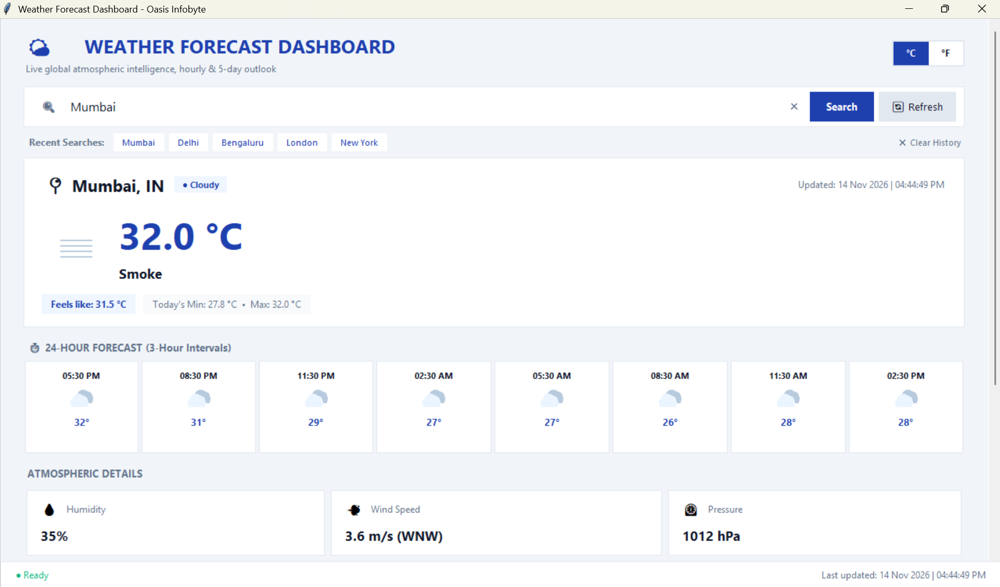
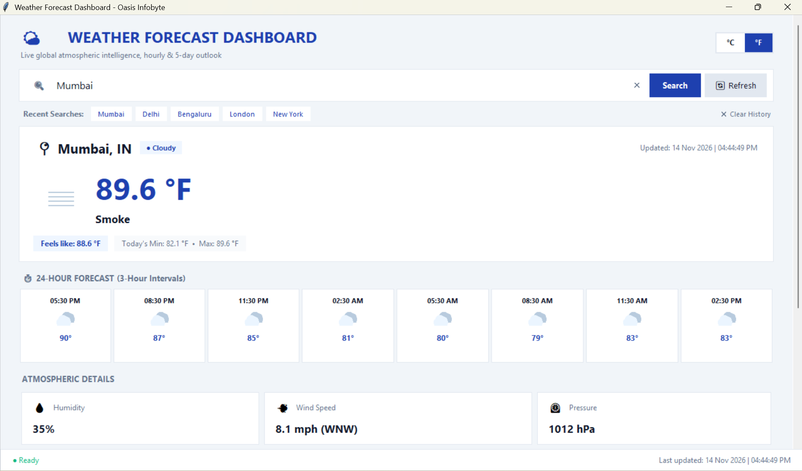
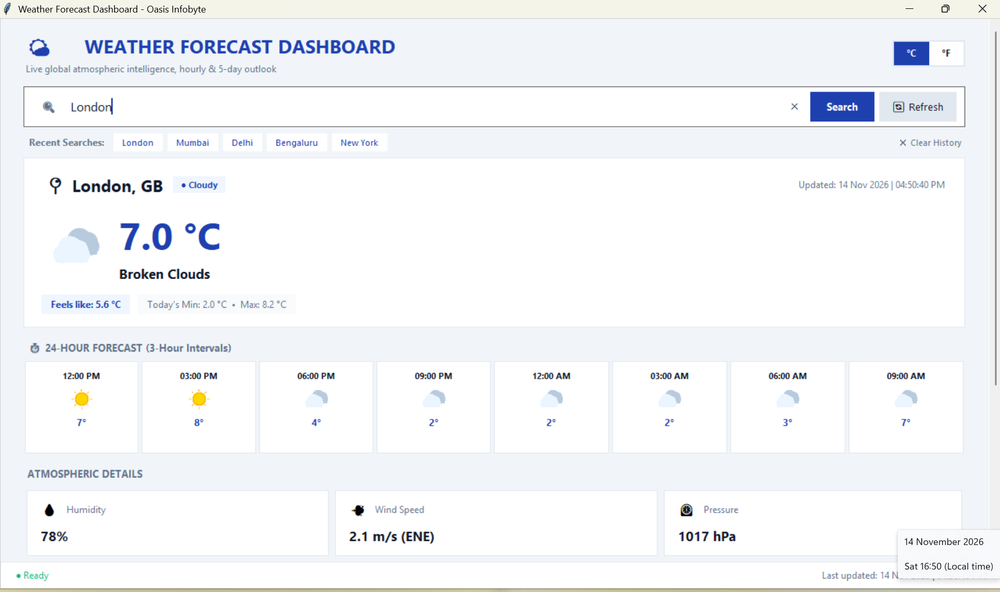
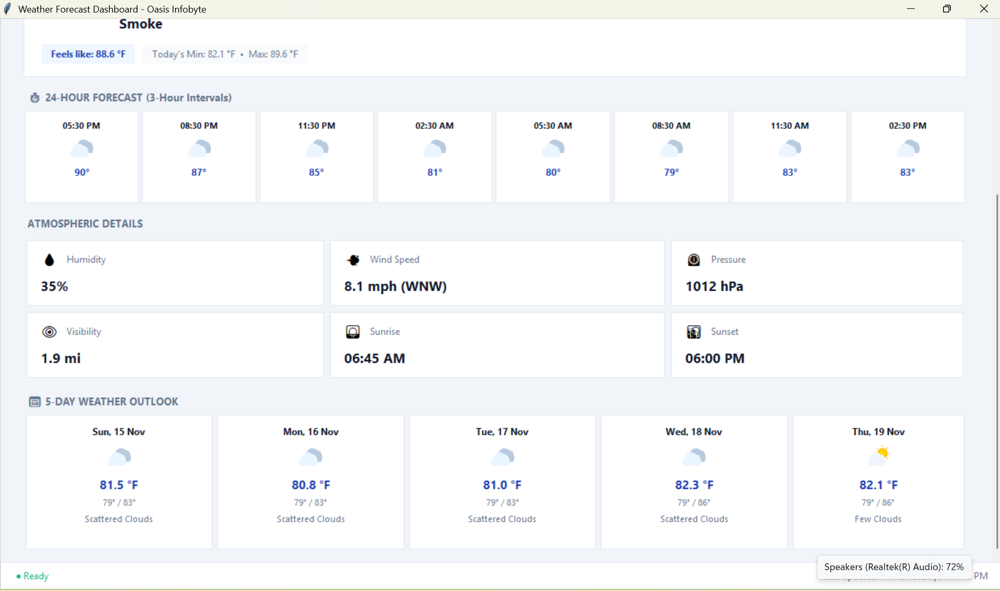
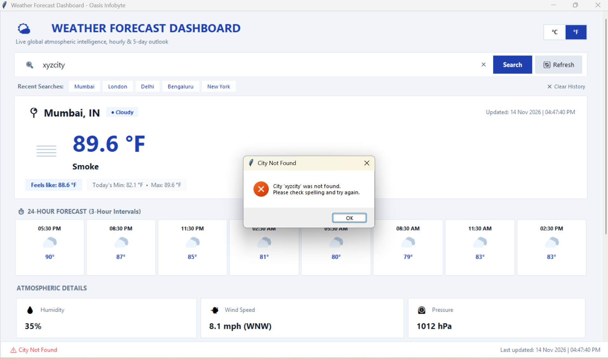

# Weather Forecast Desktop Application – Professional Edition

A modern, premium desktop weather dashboard built with Python, Tkinter, and the OpenWeatherMap API as part of the **Oasis Infobyte Python Programming Internship (Task 4)**.

---

## About the Project

This desktop application provides real-time global weather intelligence, true daily temperature extremes, a 24-hour hourly forecast, a 5-day daily outlook, and atmospheric advisory alerts for any valid city worldwide.

The user interface has been engineered with a modern **Blue & White Dashboard** aesthetic, featuring non-blocking background worker threads, vibrant local PNG weather icons (eliminating black silhouette glitches), condition-based dynamic theming, interactive tooltips, dynamic unit conversions (°C $\leftrightarrow$ °F), deduplicated recent search history, and resilient error recovery.

---

## Features

### 1. Real-Time Atmospheric Intelligence
* **Location & Country**: Displays city name and ISO country code (e.g., `Mumbai, IN`).
* **Current Temperature**: High-contrast, prominent primary temperature indicator with dynamic condition theme accent.
* **"Feels Like" Temperature**: Apparent temperature accounting for humidity and wind chill.
* **True Daily Temperature Extremes**: Accurately computes today's true minimum and maximum temperatures from forecast interval observations rather than identical instantaneous station readings.
* **Atmospheric Details**:
  * 💧 **Humidity**: Relative ambient moisture percentage.
  * 💨 **Wind Speed & Direction**: Velocity in `m/s` or `mph` with 16-point cardinal compass heading (e.g., `3.6 m/s (W)`).
  * ⏲️ **Pressure**: Barometric pressure measured in hectopascals (`hPa`).
  * 👁️ **Visibility**: Horizontal optical clarity in kilometers or miles.
  * 🌅 **Sunrise & 🌇 Sunset**: Local solar ephemeris dynamically adjusted to the city's specific UTC timezone offset.

### 2. 24-Hour Hourly Forecast
* Displays 8 upcoming 3-hour interval forecast pills.
* Shows time label, 32×32 colorful weather icon, expected temperature, and precipitation probability (`💧 XX%`).

### 3. 5-Day Daily Weather Outlook
* 5 detailed daily forecast cards featuring:
  * Day and calendar date (`Today`, `Tue, 11 Nov`, etc.).
  * Colorful weather icon.
  * Expected daytime temperature.
  * Daily low and high range (`Min° / Max°`).
  * Descriptive weather conditions (e.g., *Few Clouds*, *Light Rain*, *Sunny*).
  * Daily precipitation probability.

### 4. Dynamic Weather Themes & Alert Banners
* **Dynamic Condition Theming**: Accents subtly adapt to real-time weather conditions:
  * ☀️ **Sunny / Clear**: Amber Gold & Sky Blue
  * 🌧️ **Rainy / Drizzle**: Royal Oceanic Blue
  * ⚡ **Thunderstorm**: Deep Violet & Purple
  * ❄️ **Snowy**: Ice Cyan & Frost Blue
  * 🌫️ **Misty / Foggy**: Cool Slate Gray
  * ☁️ **Cloudy**: Classic Royal Navy
* **Atmospheric Alert Banner**: Displays prominent advisories when adverse weather occurs (thunderstorms, heavy precipitation, gale winds $\ge 12\text{ m/s}$, dense fog $< 2\text{ km}$, extreme heat $\ge 40^\circ\text{C}$, sub-zero freezing $\le 0^\circ\text{C}$).

### 5. UI/UX & Desktop Ergonomics
* **Vibrant Weather Icons**: High-contrast, colorful 64×64 and 32×32 RGBA PNG icons loaded natively in Tkinter. Zero black or broken glyphs.
* **Interactive Tooltips**: Hover over atmospheric detail cards to view concise educational explanations for each metric.
* **Instant Unit Conversion (°C $\leftrightarrow$ °F)**: Live toggle between Metric and Imperial units updating current readings, 24-hour pills, and 5-day cards without re-fetching.
* **Non-Blocking Background Threading**: API calls run on background worker threads (`threading.Thread`) with thread-safe UI callbacks (`root.after()`). The interface never freezes or shows Windows "(Not Responding)" states.
* **Recent Searches**: Clickable chips for recent and popular cities with automatic deduplication.
* **Clear History**: Dedicated button to reset session search history.
* **One-Click Refresh**: Dedicated refresh button and <kbd>F5</kbd> keyboard shortcut.
* **Keyboard Navigation**: Press <kbd>Enter</kbd> to search immediately.
* **Responsive Scrollable Canvas**: Window adjusts smoothly to different display sizes with mouse wheel scrolling support.

---

## Technologies Used

* **Python** (3.10, 3.11, or 3.12)
* **Tkinter** (Python's native GUI toolkit with native PNG image support)
* **Requests** (HTTP client for REST API communication)
* **Python-dotenv** (Secure credential isolation from environment files)
* **OpenWeatherMap API** (`/data/2.5/weather` and `/data/2.5/forecast` endpoints)

---

## Project Structure


```text
Python-Task4-WeatherApp/
│
├── main.py
├── weather_service.py
├── capture_actual_screenshots.py
├── test_weather_service.py
├── test_gui.py
├── requirements.txt
├── .env.example
├── .gitignore
├── README.md
│
├── assets/
│   └── icons/
│       ├── 01d.png, 01n.png
│       ├── 02d.png, 02n.png
│       ├── 03d.png, 04d.png
│       ├── 09d.png, 10d.png
│       ├── 11d.png, 13d.png
│       └── 50d.png
│
└── screenshots/
    ├── weather-dashboard-celsius.png
    ├── unit-conversion-fahrenheit.png
    ├── weather-search-details.png
    ├── forecast-details.png
    └── error-handling.png
```

## Application Screenshots

### 1. Main Dashboard (24-Hour & 5-Day Outlook - Metric View)


### 2. Unit Conversion (Fahrenheit / Imperial View)


### 3. Weather Search & Atmospheric Metrics Grid


### 4. Forecast Details (24-Hour & 5-Day Outlook)


### 5. Resilient Error Handling


---

## Installation & Setup

### Prerequisites
* Python 3.10, 3.11, or 3.12 installed on your system.
* Active internet connection for live weather queries.
* Free OpenWeatherMap API Key.

### Step 1: Clone the Repository

```bash
git clone https://github.com/sujit-prajapati/OIBSIP.git
```

### Step 2: Navigate to Project Directory

```bash
cd OIBSIP/Python-Task4-WeatherApp
```

### Step 3: Create a Virtual Environment

```bash
python -m venv .venv
```

### Step 4: Activate the Virtual Environment

* **On Windows (PowerShell):**
  ```powershell
  .\.venv\Scripts\Activate.ps1
  ```
* **On Windows (Command Prompt):**
  ```cmd
  .\.venv\Scripts\activate.bat
  ```
* **On macOS / Linux:**
  ```bash
  source .venv/bin/activate
  ```

### Step 5: Install Dependencies

```bash
python -m pip install -r requirements.txt
```

---

## OpenWeatherMap API Key Setup

1. Register for a free account at [OpenWeatherMap](https://home.openweathermap.org/users/sign_up).
2. Go to your account profile and copy your **API Key**.

3. Create a `.env` file in the `Python-Task4-WeatherApp` directory by copying `.env.example`.

   **Windows PowerShell:**
   ```powershell
   Copy-Item .env.example .env
   ```

   **Linux / macOS:**
   ```bash
   cp .env.example .env
   ```

4. Open `.env` and paste your API key:
   ```env
   OPENWEATHER_API_KEY=your_actual_api_key_here
   ```

> **Security Note:** Never commit your `.env` file or hardcode your API key into source code. `.env` is listed in `.gitignore` to prevent accidental credential leakage.

---

## How to Run the Application

With your virtual environment activated and `.env` configured, run:

```bash
python main.py
```

### Keyboard Shortcuts
* <kbd>Enter</kbd>: Execute search for entered city.
* <kbd>F5</kbd>: Refresh weather for the current city.

---

## Running the Automated Test Suite

Run the comprehensive unit and integration test suite:

```bash
python -m unittest discover -s . -p "test_*.py"
```

Verified test coverage includes:
- Live weather and 5-day forecast API parsing
- 24-hour hourly forecast interval extraction
- True daily minimum and maximum temperature calculation
- Weather alert and advisory detection
- Dynamic condition theme assignment
- 16-point wind compass heading conversion
- Celsius / Fahrenheit instantaneous conversions
- Non-blocking loading state transitions
- Error recovery (404 Not Found, 401 Unauthorized, 429 Rate Limit, Offline, Timeouts)

---

## Error Handling & Reliability

| Scenario | HTTP / Error Code | Application Response |
| :--- | :--- | :--- |
| **Empty Input** | Client validation | Displays input warning dialog prompting for city name. |
| **Invalid City Name** | `404 Not Found` | Displays friendly "City Not Found" dialog with spelling suggestions. |
| **Missing / Bad API Key** | `401 Unauthorized` | Alerts the user to verify the `OPENWEATHER_API_KEY` in `.env`. |
| **API Limit Reached** | `429 Rate Limit` | Informs user of temporary throttling without crashing. |
| **Internet Disconnected** | `ConnectionError` | Displays a clear network connectivity prompt. |
| **Slow Network** | `Timeout` | Gracefully catches timeouts after 10s and informs the user. |

---

## Developer

**Sujit Prajapati**  
GitHub: [https://github.com/sujit-prajapati](https://github.com/sujit-prajapati)

## Internship Details

* **Program**: Oasis Infobyte Python Programming Internship
* **Domain**: Python Programming
* **Task**: Task 4 – Weather Forecast Application
